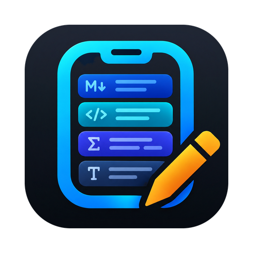
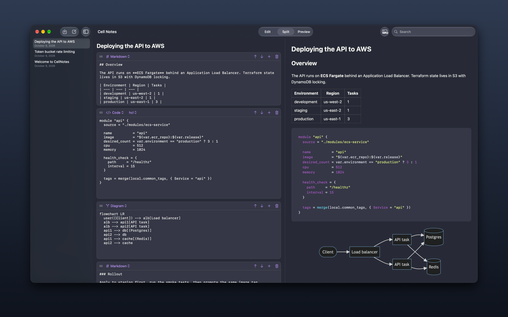
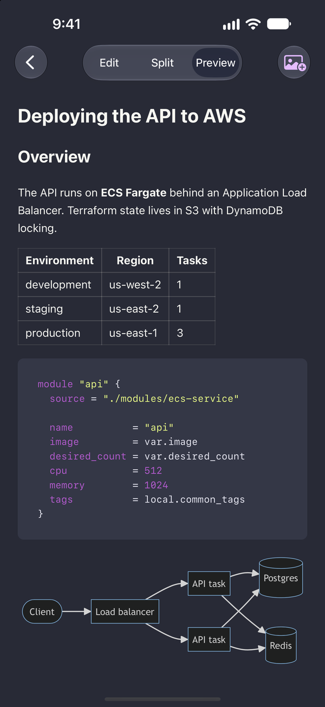
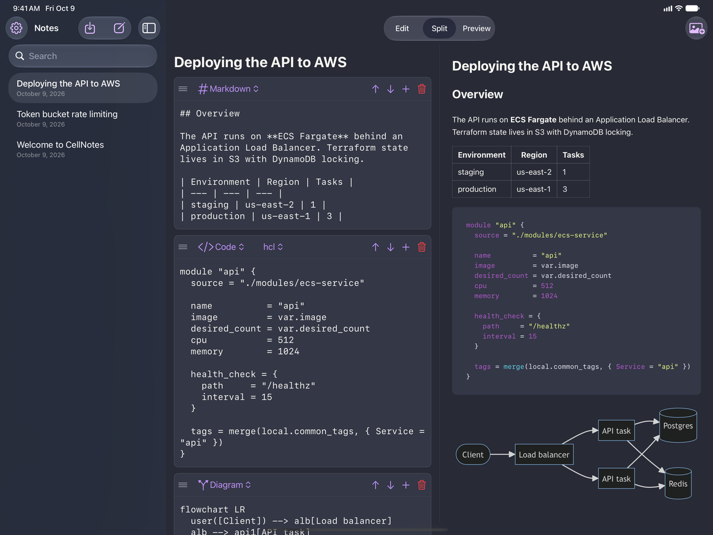

  

<h1 align="center">CellNotes</h1>

  Notes made of cells, for Mac, iPhone and iPad.

---

CellNotes is a note app where every note is a stack of cells. Write a paragraph in Markdown, drop in a
block of code, follow it with an equation and a diagram, and each part is edited and rendered the way
it should be. If you used [Quiver](https://yliansoft.com/quiver) and miss it, this is meant to feel
familiar.

> **Status:** early development. Expect rough edges, and keep a backup of anything important.

  

## Features

- **Cells of different types in one note**
  - Text and Markdown
  - Code, with syntax highlighting for 20+ languages
  - LaTeX maths, rendered with KaTeX
  - Diagrams written in [Mermaid](https://mermaid.js.org)
  - Images, pasted straight from the clipboard
  - Checklists
  - Optional extras you can switch on: tables, callouts, links and file attachments
- **Edit, Split and Preview modes**: write on one side, see the rendered note on the other
- **Syncs with iCloud Drive** across your Mac, iPhone and iPad
- **Your notes are plain files**: JSON and ordinary image files in a folder you can see in Finder and
  the Files app, so nothing is locked inside the app
- **Imports your Quiver library**, including images
- **Themes**: System, Light, Dark, Solarized Light, Solarized Dark, Dracula, Nord and One Dark
- **Works offline**: preview rendering is built into the app

  
  &nbsp;
  

## Download

| Platform | |
| --- | --- |
| macOS 14 or later | Download the latest `.dmg` from [Releases](../../releases) |
| iPhone and iPad (iOS 17 or later) | Coming later |

## Using CellNotes

- **Add a cell:** press the **+** in any cell's header and pick a type. On a Mac or with a hardware
  keyboard, **Shift+Return** adds a cell below the one you're typing in.
- **Change a cell's type:** use the menu at the top left of the cell.
- **Paste a screenshot:** copy it, then press **Shift+Command+V** (or the photo button in the toolbar).
- **Checklists:** Return adds an item; Delete in an empty item removes it.
- **Bring in Quiver notes:** press the import button in the note list and choose your `.qvlibrary`.
- **Choose where notes live:** Settings > Library lets you pick iCloud Drive, this device only, or any
  folder.

## Where your notes are stored

With iCloud Drive on, notes live in the **CellNotes** folder in iCloud Drive. Each note is a folder
containing a `note.json` file and an `assets` folder for its images and attachments. You can back
these up, search them, or read them with other tools.

## Privacy

CellNotes collects no data. See the [privacy policy](https://cellnotes.swolfe.io/privacy).

## Feedback

Found a bug or have an idea? [Open an issue](../../issues/new/choose). This repository holds releases
and the issue tracker; the app's source code is not public.
